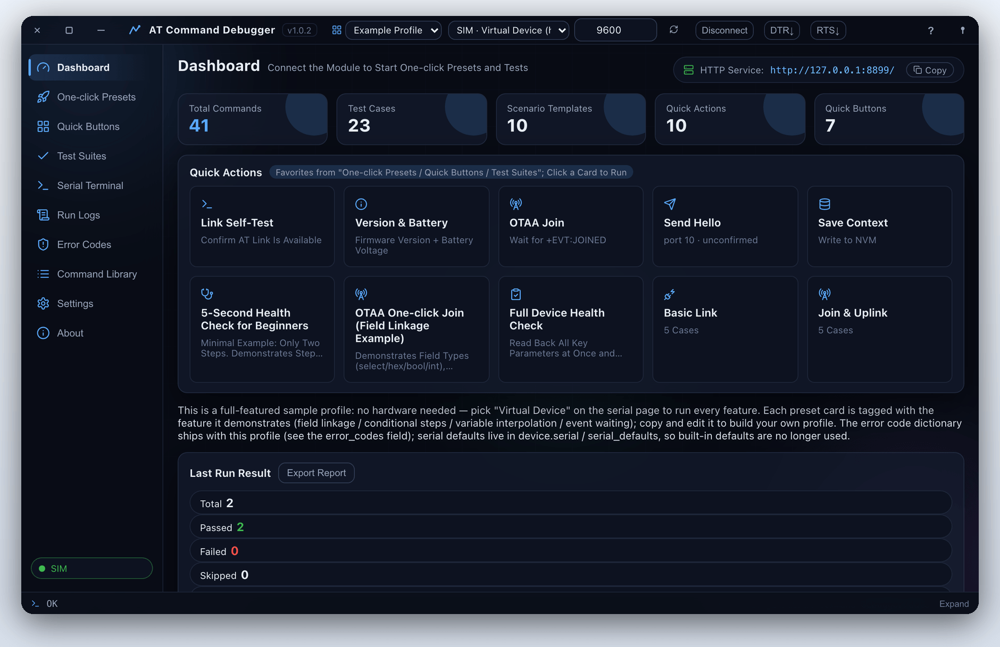
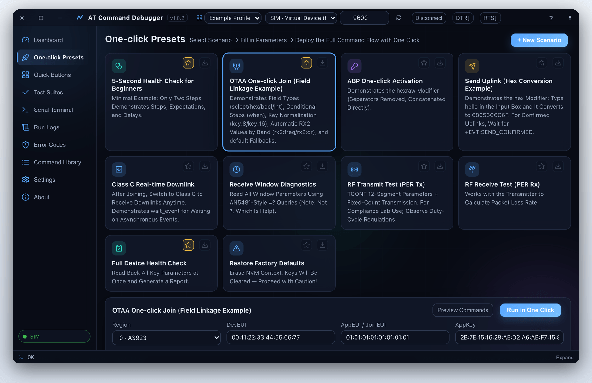
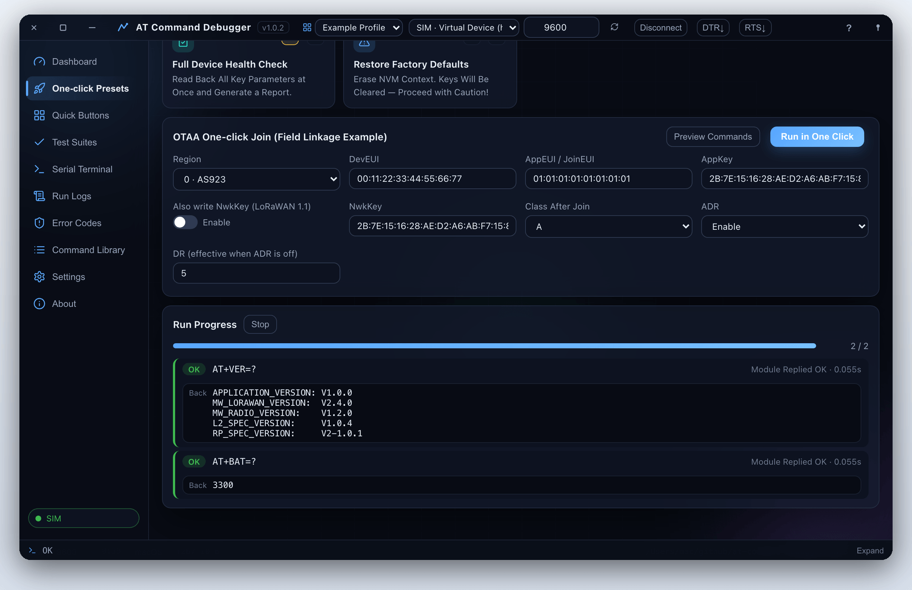
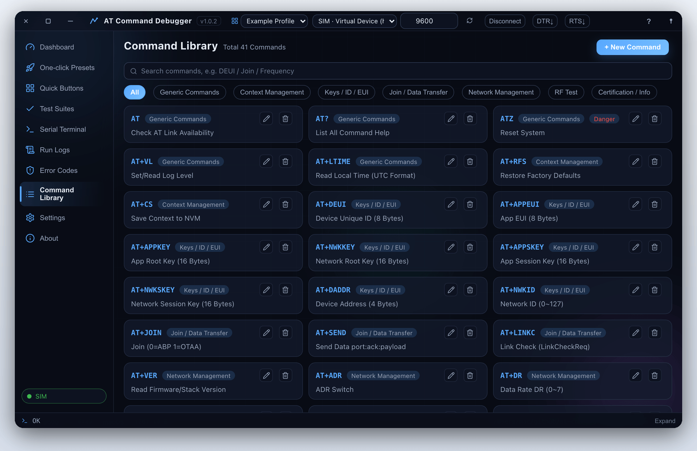
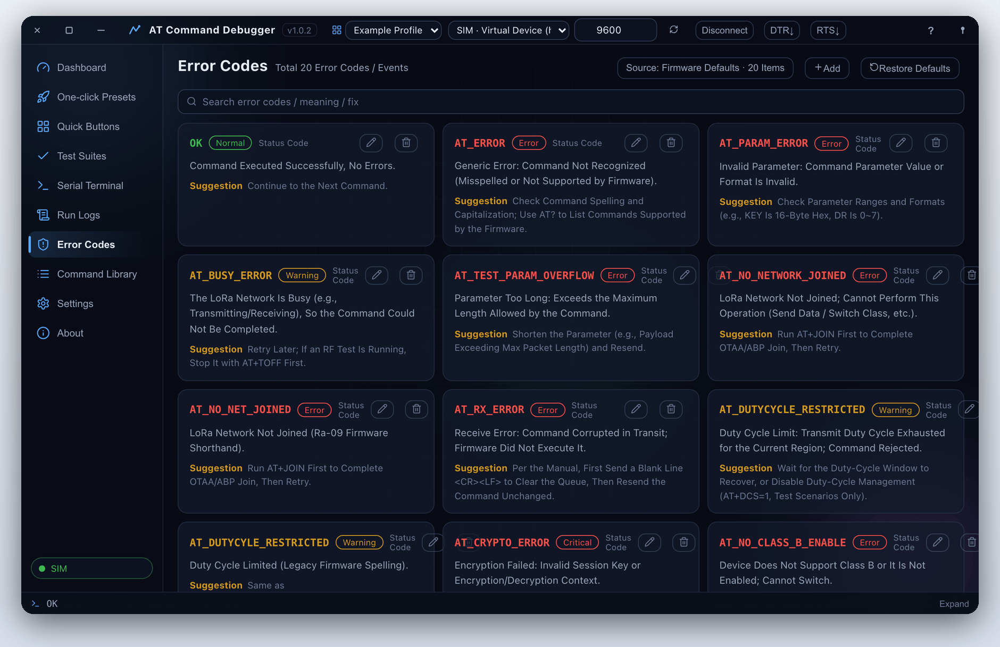
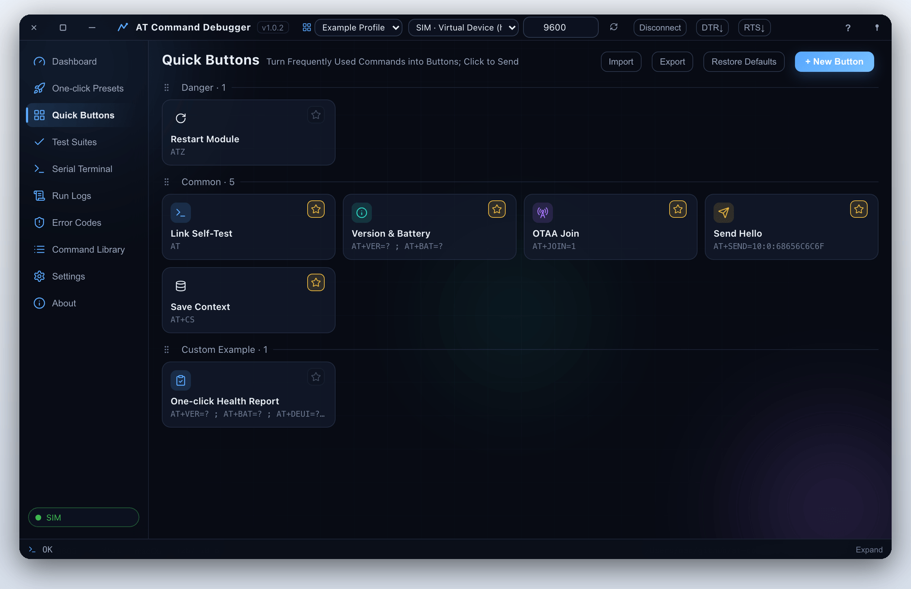
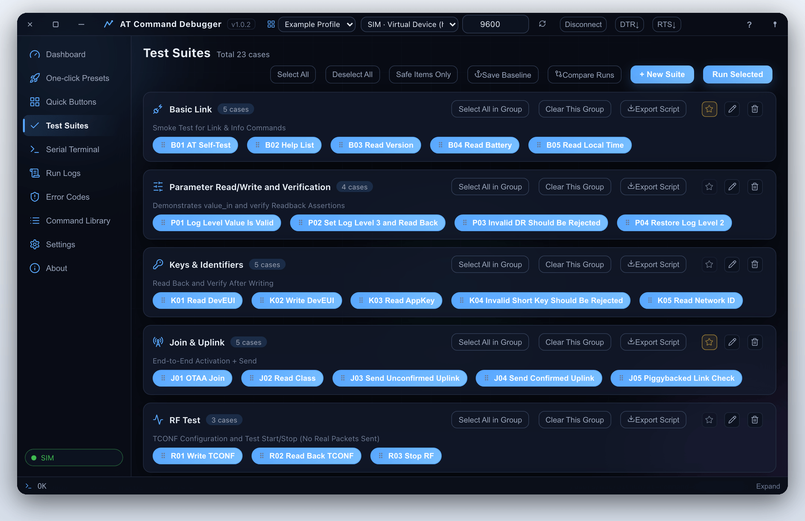
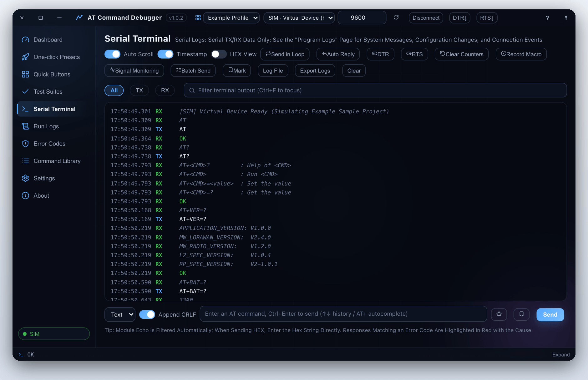
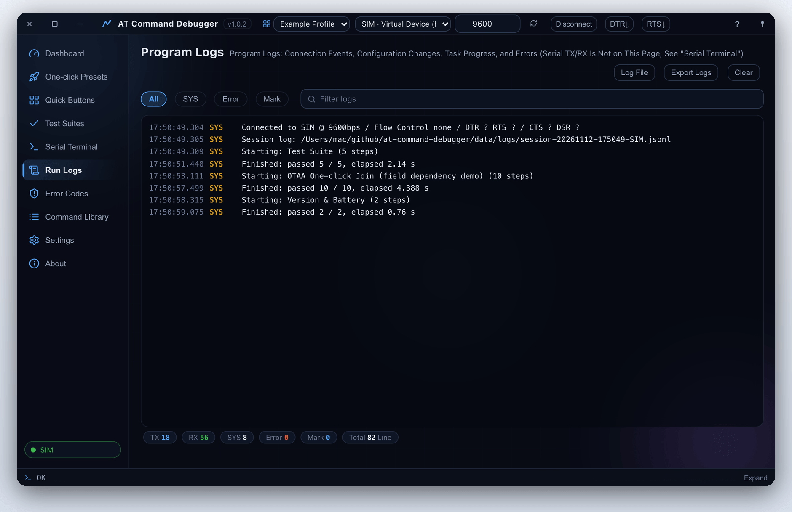
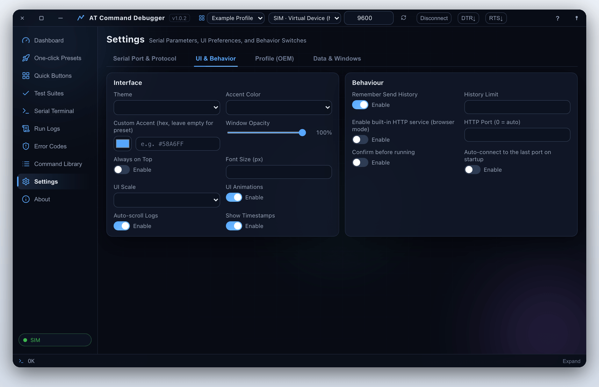

<div align="center">


# AT Command Debugger

### Any AT module, one place to debug it all.

**Pick a scenario → fill in the parameters → preview the command sequence → run it in one click → export the report.**<br>
Command sets are declarative JSON profiles, so switching modules never means changing code. A built-in virtual device runs the whole workflow without hardware.

[](LICENSE)
[]()
[]()

[简体中文](README.md) · **English**

<br>



<sub>Dashboard with the built-in virtual device (SIM) connected: link state, scenario and case counts, quick actions, and the most recent run result.</sub>

</div>

<br>

## Is it for you?

Testing an AT firmware by hand means memorising the parameter ranges and the order of dozens of commands. Typing them one by one in a bare terminal is slow, error-prone, and leaves no proper record. AT Command Debugger pulls all of that into one desktop app:

- **The command set is data, not code**: commands, categories, scenarios, suites, buttons, error codes and simulator replies all live in an external `profile.json`. Switch profiles and the app becomes a dedicated host tool for another module.
- **Bad parameters never reach the serial port**: range / HEX / enum / regex validation, with examples and help, so nothing is left to guesswork.
- **Runs are reproducible**: one-click presets send a whole configuration flow in the right order; test suites include negative cases and read-back checks, with baselines, automatic diffing on reruns and exportable reports.
- **No hardware required**: the built-in device simulator (`SIM` port) implements command replies, traffic and events, for demos, development and automated testing.

If you only occasionally type `AT` to see whether `OK` comes back, the serial tool shipped with your OS is enough. It earns its place when you tune parameters repeatedly, run regressions, or support several modules.

Tech stack: **Python + PyWebView (native WebView) + Rosezm / vanilla HTML/CSS/JS**, one codebase built for all three platforms. A `--browser` mode serves the same UI over HTTP.

## Quick start

**1 · Install**. Clone the repo, install dependencies and build the frontend:

```bash
cd at-command-debugger
npm install                  # rosezm 0.2.2 and the toolchain from npm
npm run build                # frontend compiled into dist/
python main.py               # launch the desktop app
python main.py --browser --open   # or: browser mode
python main.py --selftest    # self-test (including the simulator link)
```

<sub>Windows needs Edge WebView2 (bundled with Win11), macOS uses the built-in WebKit, Linux needs `libwebkit2gtk-4.0-dev`. Python 3.10+. No hardware is required — the built-in simulator covers the full workflow; real-device testing needs a USB serial port and a module.</sub>

**2 · Connect**. Pick a port in the serial bar (or `SIM` for the virtual device), set the baud rate to match the firmware and click Connect.

**3 · Run a scenario**. Open **One-click Presets**, choose *Quick Check*, fill in the form → preview the command sequence → run it.

**4 · Export a report**. Open **Test Suites**, select a group of cases and run them; results export to Markdown / CSV / HTML / JSON.

Frontend hot reload: run `python main.py --browser` in one terminal and `npm run dev` in another; `npm run check` type-checks the `.rose` sources.

## Features

### One-click presets

Ten scenario templates (device checkup / OTAA join / ABP activation / uplink / Class C downlink / PER RF tx & rx / factory reset and more). Cards take a form → preview the command sequence → step through or run in one click, with pinning and reordering. Fields support dependency, HEX conversion and conditional steps.

<table>
<tr>
<td width="50%"></td>
<td width="50%"></td>
</tr>
</table>

### Command library and error codes

The command library filters by category, validates parameters, shows examples and help, flags dangerous commands, and can be edited in-app. When a reply matches an error code, the dictionary explains its meaning, severity and suggested fix — and is editable in-app too.

<table>
<tr>
<td width="50%"></td>
<td width="50%"></td>
</tr>
</table>

### Quick buttons and test suites

Frequent commands become buttons: multi-command sequences, groups, colours and icons, `{variable}` placeholders filled in on click, persisted per profile with import/export. Test suites hold 6 groups / 23 cases, run by selected group, and support saved baselines, automatic diffing on reruns and exported scripts and reports.

<table>
<tr>
<td width="50%"></td>
<td width="50%"></td>
</tr>
</table>

### Serial terminal

Colour-coded TX / RX / system messages, timestamps, command history (↑↓), text / HEX views, loop send, keyword auto-reply, multi-line batch send (with `#` comments and WAIT), macro recording, an RSSI trend chart, log bookmarks and byte-counter reset. Serial parameter changes take effect immediately with a silent reconnect.



Live DTR / RTS switches sit in the serial bar to diagnose cases where opening the port resets the module or drops it into the bootloader — the classic "other tools receive data, this one doesn't".

### Run logs and settings

Run logs keep connection events, profile switches, task progress and errors in one place, filterable by category and exportable. Settings are split into serial & protocol, interface & behaviour, profiles (OEM), and data & API.

<table>
<tr>
<td width="50%"></td>
<td width="50%"></td>
</tr>
</table>

### At a glance

| Module | What it does |
| :-- | :-- |
| **One-click presets** | 10 scenario templates; form → command preview → step or run in one click |
| **Command library** | Declarative manual with range / HEX / enum / regex validation, examples and help; invalid parameters are rejected before the serial port |
| **Test suites** | 6 groups / 23 cases including negative cases and read-back checks; partial runs, saved baselines, rerun diffing, Markdown / CSV / HTML / JSON export |
| **Error code dictionary** | Reply codes maintained per profile: meaning, severity and fix shown in the terminal, editable in-app |
| **Custom buttons** | Multi-command sequences, groups, colours and icons, `{variable}` placeholders; persisted per profile, import/export |
| **Serial terminal** | Colour-coded logs, timestamps, history, HEX view, loop send, auto-reply, batch send, macros, RSSI trend, bookmarks |
| **Pin control** | Live DTR / RTS switches for level-reset issues when a port is opened |
| **Virtual device** | Built-in simulator (`SIM` port); demos, development and automated testing need no hardware |
| **Profiles (OEM)** | A module's whole "personality" in an external `profile.json`; switch from the title bar, no code changes |
| **Test reports** | Suite results to Markdown / CSV / HTML / JSON; terminal logs, config and button sets as JSON packages |
| **Modern UI** | Frameless window with native drag / eight-way resize, geometry remembered across sessions, opacity and always-on-top; dark/light themes, four accent colours plus custom, 85–115 % UI scaling, splash and transitions, pin-to-dashboard |

## Profiles (OEM mechanism)

**One profile = a module's entire "personality"**: a single JSON file decides everything the app shows and sends. Two directories are merged, with the user directory winning on name collisions:

```
<app dir>/profiles/<id>/profile.json     built-in (external folder next to the exe, read-only)
<data dir>/profiles/<id>/profile.json    user-created / imported (writable, takes priority)
```

A sample profile ships with the app to demonstrate every feature and serve as a starting point. Apart from `id` / `name`, every field is optional and falls back to a built-in default: `brand`, `subtitle`, `icon`, `version`, `doc`, `categories`, `commands`, `error_codes`, `presets`, `quick_actions`, `suites`, `buttons`, `device` and more.

Validation is serialisable declarative data (`{"type":"range","low":0,"high":9}`, `{"type":"hex","size":8}`, `{"type":"choice",...}`, `{"type":"any","of":[...]}`); scenario steps are templates with filter interpolation (`{token|key:8}`, `{text|hex}`, `{x|default:5}`); conditional steps support `when: "!debug" | "mode==1" | "a&&b" | "a||b"`.

Typical workflow: edit visually in **Settings → Profiles** (commands, scenarios, suites, error codes and pinned home items can all be added, removed and reordered in-app), or take the JSON route — copy the built-in *Example* profile → export → edit the JSON → import → verify → drop it into the `profiles/` folder next to the exe to make it built-in (packaged builds read the external folder; dev mode reads the project root `profiles/`). Export packages carry a `{"kind":"at-command-debugger-profile","format":1,...}` marker.

## Command-line options

| Option | Meaning |
| :-- | :-- |
| (none) | Launch the desktop app (default) |
| `--browser` | No desktop window, local HTTP service only |
| `--open` | With `--browser`: open the system browser automatically |
| `--host` / `--port` | Browser-mode bind address / port (0 = automatic) |
| `--no-http` | Desktop mode without the auxiliary HTTP service |
| `--debug` | Open WebView developer tools |
| `--verbose` | Verbose logging |
| `--selftest` | Self-test, then exit |
| `--instance NAME` | Multiple instances: separate data directory and lock, so several windows can control different devices |

## Data directory

All data lives beside the program (portable and green, identical on all three platforms) — no installer, no registry writes:

| Path | Contents |
| :-- | :-- |
| `profiles/config.json` | All app settings (serial, protocol, UI, window, behaviour) |
| `profiles/<id>/profile.json` | Each profile (command library, scenarios, suites, …) |
| `profiles/<id>/buttons.json` | Custom buttons per profile |
| `profiles/<id>/errorcodes.json` | Error code dictionary per profile |
| `data/history/` | Send history, one file per day |
| `data/exports/` | Reports and export packages |
| `data/backups/` | Backups taken on config migrations |
| `data/baselines/` | Test baselines |
| `data/logs/debugger.log` | Rolling application log |

The legacy `%APPDATA%` directory is read once for migration: old data is moved into the program folder on first run, without overwriting existing files. Missing config files are generated on first launch (missing keys filled in automatically); with no profiles at all, a sample profile is generated so the app works out of the box. Everything is plain JSON / text — delete it to restore defaults.

## FAQ

<details>
<summary><b>Connected, but nothing is received or sent</b></summary>

<br>

Almost always wiring or module state, not the software. Check in order: the selected port is a real USB serial port (not an ACPI placeholder); TX↔RX are crossed and grounds are shared; the module is powered and not held in reset; the baud rate matches the firmware; if the module entered transparent mode, send `+++` first (no carriage return, one second of silence before and after) and then `AT`. When the module returns 0 bytes, the send-failure message includes this checklist.

</details>

<details>
<summary><b>The module resets or goes silent as soon as I connect</b></summary>

<br>

Some firmware is sensitive to DTR/RTS levels at the instant the port opens. Flip the DTR / RTS switches in the serial bar after connecting.

</details>

<details>
<summary><b>The profile selector disappeared</b></summary>

<br>

It hides automatically when only one profile exists. Create or import another one in **Settings → Profiles**.

</details>

<details>
<summary><b>Browser mode reports a connection error</b></summary>

<br>

Another instance may be holding the HTTP port. Pin it with `--port`, or give the instance its own data directory with `--instance`.

</details>

## Project structure

<details>
<summary><b>Expand the tree and common customisations</b></summary>

<br>

```
package.json / package-lock.json
build.py / atcdbg.spec
src/                        Rosezm frontend sources (.rose pages + components)
public/                     static assets (synced into dist/: icons, fonts, css)
scripts/                    asset sync + smoke gate
profiles/
atcdbg/
├── core/
│   ├── serial_mgr.py
│   ├── runner.py
│   ├── protocol.py
│   ├── commands.py
│   ├── presets.py
│   ├── suites.py
│   ├── buttons.py
│   ├── device_sim.py
│   ├── profiles.py
│   ├── validators.py
│   ├── exporter.py
│   ├── config.py
│   ├── paths.py
│   └── winnative.py
└── webui/
    ├── app.py
    └── backend.py
```

- **Support a new module**: copy and edit a profile JSON — commands, scenarios, suites, buttons and simulator replies are all data, no Python needed.
- **Add a backend call**: add a public method in `webui/backend.py`; the frontend dispatches through the shared `invoke` entry point.
- **Change the frontend**: edit the `.rose` sources under `src/`; `npm run dev` hot-reloads against a running `--browser` backend, `npm run check` type-checks.
- **Verify the environment**: `python main.py --selftest` checks the command library, suites, simulator link and paths without opening a window.

</details>

## Packaging

<details>
<summary><b>Single-file executables for all three platforms</b></summary>

<br>

```bash
build_windows.bat     # Windows
bash build_mac.sh     # macOS
bash build_linux.sh   # Linux (needs WebKitGTK, see the script comments)
```

Each script installs the node dependencies (`npm install`), builds the frontend (`npm run build`), then packages the Python backend with PyInstaller. Equivalent manual commands:

```bash
npm install
npm run build
python build.py
```

The result is a **single-file executable**: `dist/AT指令调试台.exe` (`dist/AT指令调试台` on macOS / Linux), movable and distributable without a Python environment. Notes:

- PyInstaller only packages the current OS — no cross-compilation; run the script on the platform you want a build for
- A single-file build unpacks to a temp directory on first launch, so a slower start is normal
- **Profiles are external**: the exe bundles none of them. A `profiles/` folder is copied into `dist/` after the build and the app reads from that sibling folder; with no profiles it generates a sample one on first launch. Add or remove profile folders freely, no rebuild needed
- Icons come straight from `assets/` (`icon.png` / `icon_256.png` / `icon.ico`) and are embedded as-is; replace those files to change the icon, no generation step

GitHub Actions runs CI on every push (`.github/workflows/ci.yml`: install, type-check, frontend build, backend self-test); pushing a `v*` tag runs the same checks, then builds all three platforms with PyInstaller and publishes a pre-release, with release notes generated from commits since the previous tag (`.github/workflows/release.yml`).

</details>

## License

[Apache License 2.0](LICENSE)
