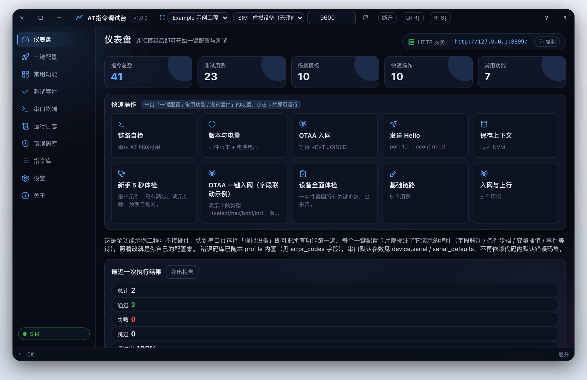
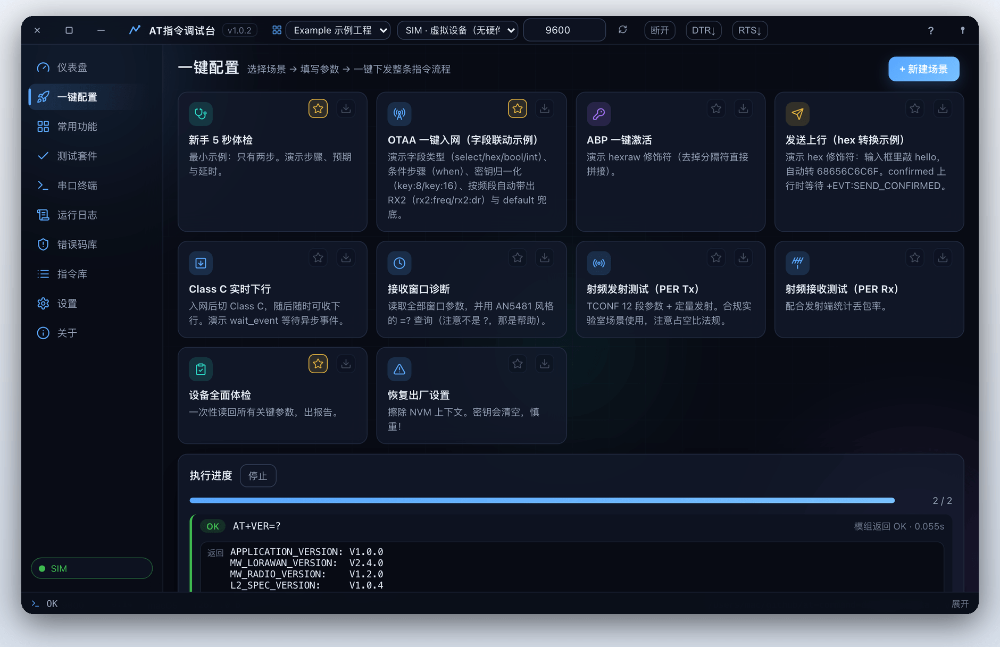
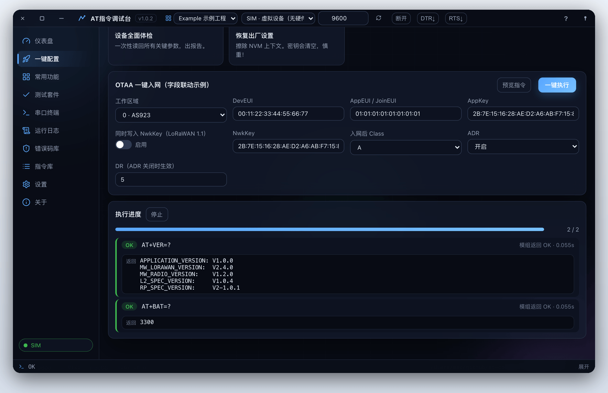
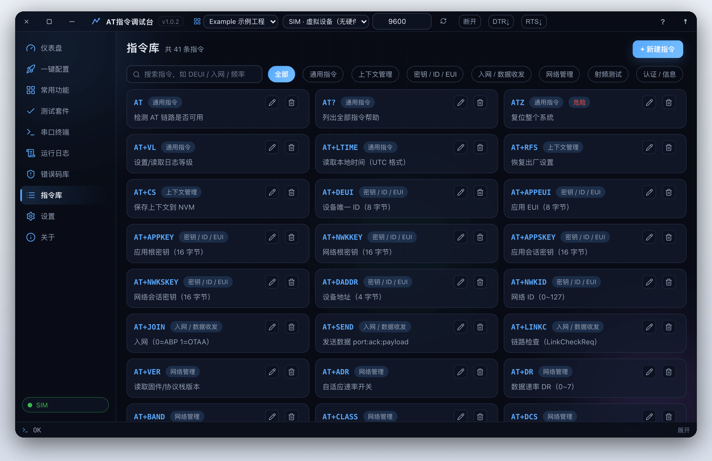
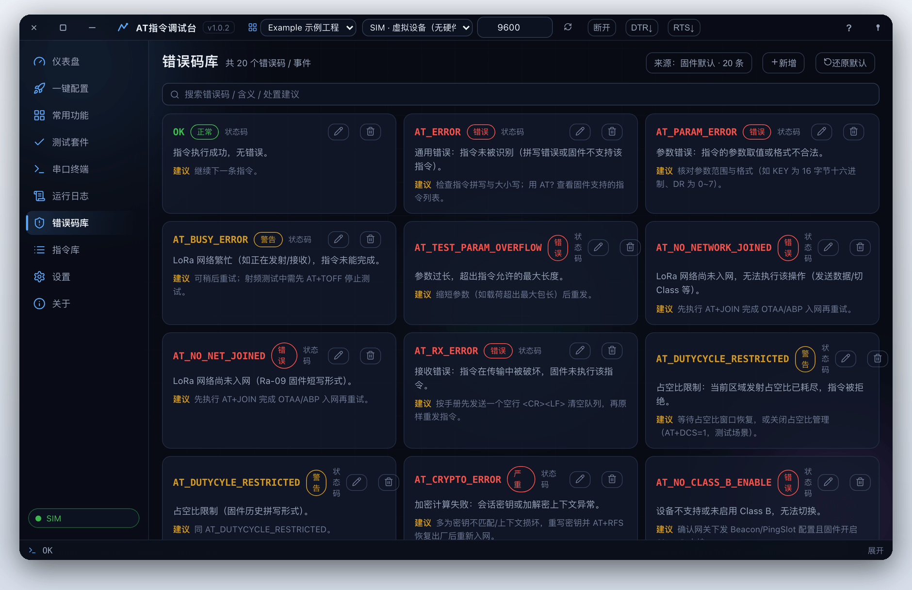
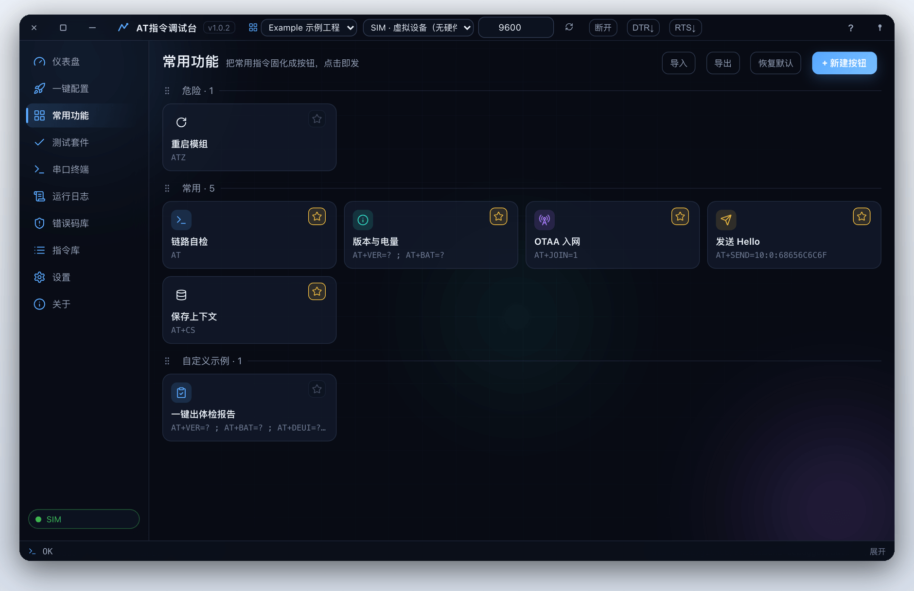
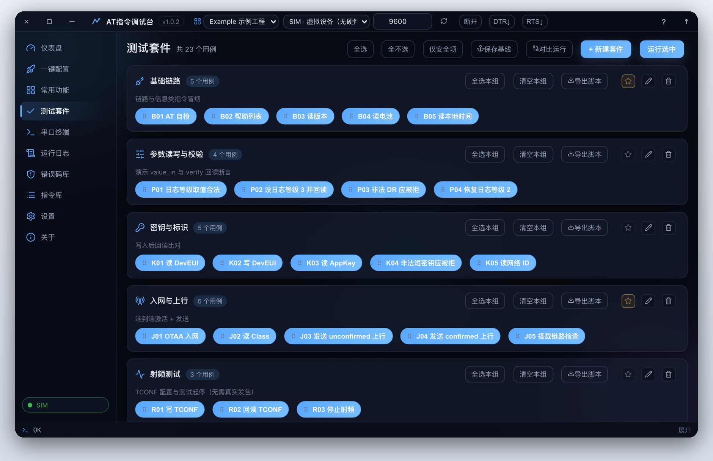
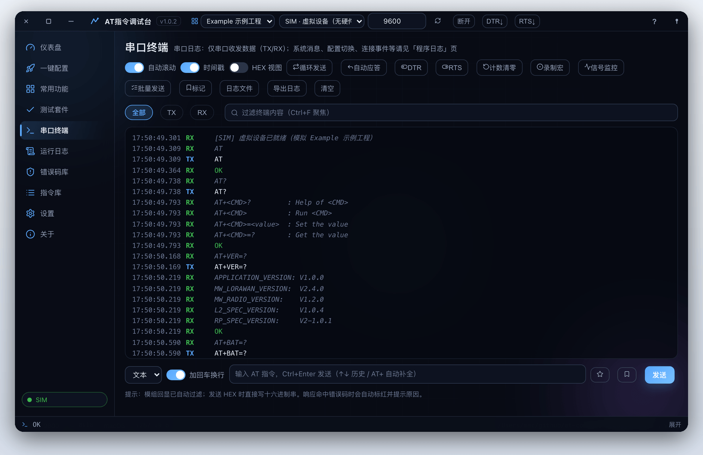
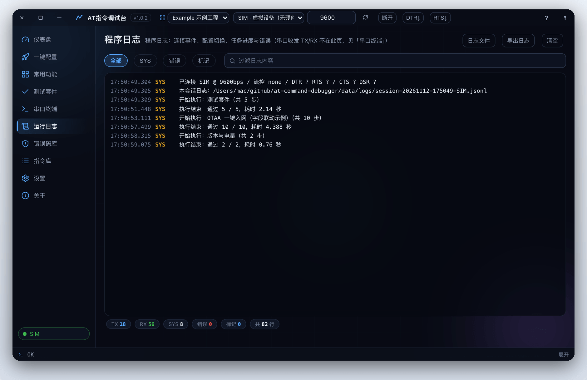
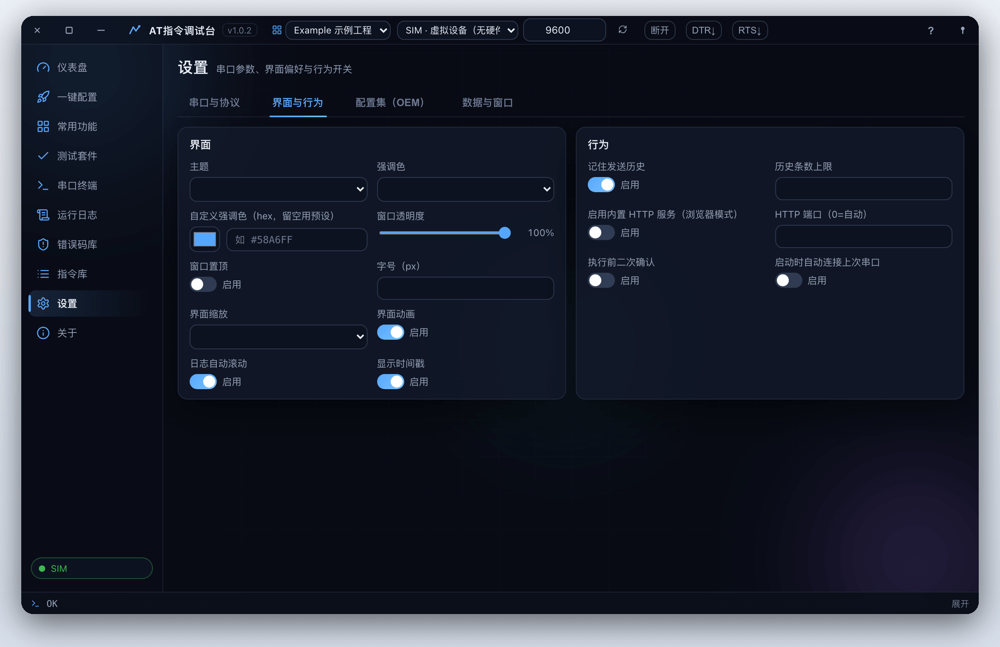

<div align="center">


# AT指令调试台

### 任意 AT 模组，一处调试搞定。

**选场景 → 填参数 → 预览指令序列 → 一键执行 → 导出报告。**<br>
指令集由声明式 JSON 配置集描述，换模组只改配置、不动一行代码。内置虚拟设备，不接硬件也能跑通全流程。

[](LICENSE)
[]()
[]()

[English](README.en.md) · **简体中文**

<br>



<sub>连接内置虚拟设备（SIM）后的仪表盘：链路状态、场景与用例统计、快捷操作和最近一次执行结果。</sub>

</div>

<br>

## 它适合你吗？

手动测一块模组的 AT 固件，要记住几十条指令的参数范围与先后顺序；在裸终端里逐条敲，慢、易错，事后也没有规范记录可查。AT指令调试台把这些收进一个桌面应用：

- **指令集是数据，不是代码**：整套指令、分类、场景、套件、按钮、错误码与模拟器应答都写在外部 `profile.json`，切换配置集应用立刻变成另一款模组的专用上位机。
- **参数在进串口前就被拦下**：范围 / HEX / 枚举 / 正则校验，配示例与帮助，不用靠猜。
- **流程可复现**：一键配置按正确顺序下发整段指令；测试套件带负向用例与回读校验，可存基线、复测自动比对差异、导出报告。
- **没硬件也能跑**：内置设备模拟器（`SIM` 端口）实现指令应答、收发与事件模型，演示、开发和自动化测试都不需要模组。

如果你只偶尔敲一条 `AT` 看有没有回 `OK`，系统自带的串口工具就够了；要反复调参、回归测试或适配多款模组，它才派得上用场。

技术栈：**Python + PyWebView（原生 WebView）+ Rosezm / 原生 HTML/CSS/JS**，一套代码编译三端；也支持 `--browser` 模式直接用浏览器访问。

## 快速开始

**1 · 安装**。克隆仓库后装依赖并编译前端：

```bash
cd at-command-debugger
npm install                  # 从 npm 安装 rosezm 0.2.2 与工具链
npm run build                # 前端编译到 dist/
python main.py               # 启动桌面应用
python main.py --browser --open   # 或：浏览器模式
python main.py --selftest    # 自检（含模拟器链路）
```

<sub>Windows 需要 Edge WebView2（Win11 自带），macOS 用内置 WebKit，Linux 需要 `libwebkit2gtk-4.0-dev`。Python 3.10+。硬件不是必需项——内置模拟器可跑通全流程，真机测试才需要 USB 串口 + 模组。</sub>

**2 · 连接设备**。串口栏选端口（或直接选 `SIM` 连虚拟设备），波特率按固件填写，点「连接」。

**3 · 跑一个场景**。打开「一键配置」，选 *设备体检*，填表 → 预览指令序列 → 执行。

**4 · 导出报告**。打开「测试套件」，勾选一类用例运行，结果可导出 Markdown / CSV / HTML / JSON。

前端热更新：一个终端跑 `python main.py --browser`，另一个跑 `npm run dev`；`npm run check` 类型检查 `.rose` 源码。

## 功能

### 一键配置

10 个场景模板（设备体检 / OTAA 入网 / ABP 激活 / 上行发送 / Class C 下行 / 射频 PER 收发 / 恢复出厂等），场景卡片填表 → 预览指令序列 → 单步或一键执行，支持置顶与排序。字段支持联动、HEX 转换与条件步骤。

<table>
<tr>
<td width="50%"></td>
<td width="50%"></td>
</tr>
</table>

### 指令库与错误码库

指令库按分类过滤，带参数校验、示例与帮助，危险指令单独标记，应用内可直接增删改；返回码命中后，错误码库给出含义、严重级别与处置建议，同样可在应用内维护。

<table>
<tr>
<td width="50%"></td>
<td width="50%"></td>
</tr>
</table>

### 常用功能与测试套件

常用指令固化成按钮：多指令序列、分组、颜色图标、`{变量}` 占位符点击时填入，按配置集持久化并支持导入导出。测试套件分 6 大类 23 个用例，分组勾选运行，支持保存基线、复测比对差异、导出脚本与报告。

<table>
<tr>
<td width="50%"></td>
<td width="50%"></td>
</tr>
</table>

### 串口终端

TX / RX / 系统消息着色、时间戳、指令历史（↑↓）、文本 / HEX 双视图、循环发送、关键字自动应答、多行批量发送（支持 `#` 注释与 WAIT 等待）、宏录制、RSSI 信号监控趋势图、日志书签、字节计数清零；修改串口参数即时生效（自动静默重连）。



DTR / RTS 实时开关放在串口栏，用来排查「别的工具能收、本工具收不到」这类因打开瞬间引脚电平复位模组或进 bootloader 的问题。

### 运行日志与设置

运行日志把连接事件、配置切换、任务进度与错误统一留痕，可按类别过滤、导出；设置分串口与协议、界面与行为、配置集（OEM）、数据与接口四个分区。

<table>
<tr>
<td width="50%"></td>
<td width="50%"></td>
</tr>
</table>

### 功能一览

| 模块 | 说明 |
| :-- | :-- |
| **一键配置** | 10 个场景模板，填表 → 预览指令序列 → 单步或一键执行 |
| **指令库** | 声明式指令手册：参数校验（范围 / HEX / 枚举 / 正则）、示例与帮助；非法参数在进入串口前就被拦下 |
| **测试套件** | 6 大类 23 个用例，含负向用例与回读校验；可勾选部分运行，可保存基线、复测自动比对差异，结果导出 Markdown / CSV / HTML / JSON |
| **错误码词典** | 按配置集维护返回码：终端命中后显示含义、严重级别与处置建议，应用内增删改排序 |
| **自定义按钮** | 多指令序列、分组、颜色图标、`{变量}` 占位符；按配置集持久化，支持导入导出 |
| **串口终端** | 着色日志、时间戳、历史、HEX 视图、循环发送、自动应答、批量发送、宏录制、RSSI 趋势、日志书签 |
| **引脚控制** | DTR / RTS 实时开关，排查打开串口瞬间的电平复位问题 |
| **虚拟设备** | 内置模拟器（`SIM` 端口），演示、开发与自动化测试都不需要硬件 |
| **配置集（OEM）** | 一款模组的完整「人格」全在外部 `profile.json`；标题栏下拉切换，不改一行代码 |
| **测试报告** | 套件结果导出 Markdown / CSV / HTML / JSON；终端日志、配置与按钮集 JSON 包导入导出 |
| **现代化界面** | 无边框窗口原生拖动 / 八向缩放、几何位置跨会话记忆、窗口透明度与置顶；深浅主题、四种强调色 + 自定义色、界面缩放 85–115 %、开屏与过渡动画、首页看板置顶 |

## 配置集（OEM 机制）

**一个配置集 = 一款模组的完整「人格」**，一个 JSON 文件决定应用显示和发送的一切。双层目录合并，同名时用户目录优先：

```
<程序目录>/profiles/<id>/profile.json     内置（exe 同级外置目录，只读）
<数据目录>/profiles/<id>/profile.json     用户自建 / 导入（可写，优先）
```

随附一份示例配置集，用于演示全部功能，也可作为新建配置集的起点。除 `id` / `name` 外全部可选，缺失自动走内置默认：`brand`、`subtitle`、`icon`、`version`、`doc`、`categories`、`commands`、`error_codes`、`presets`、`quick_actions`、`suites`、`buttons`、`device` 等。

参数校验是可序列化的声明式描述（`{"type":"range","low":0,"high":9}`、`{"type":"hex","size":8}`、`{"type":"choice",...}`、`{"type":"any","of":[...]}`）；场景步骤是模板 + 过滤器插值（`{token|key:8}`、`{text|hex}`、`{x|default:5}`）；条件步骤支持 `when: "!debug" | "mode==1" | "a&&b" | "a||b"`。

典型流程：直接在 设置 → 配置集 里可视化编辑（指令、场景、套件、错误码、首页置顶都可在应用内增删改与排序），或走 JSON 路线——复制内置 *Example 示例工程* → 导出 → 改 JSON → 导入 → 验证 → 放进 exe 同级的 `profiles/` 文件夹即为内置（打包版从程序目录外置读取；开发模式读项目根的 `profiles/`）。导出包带 `{"kind":"at-command-debugger-profile","format":1,...}` 标识。

## 命令行参数

| 参数 | 说明 |
| :-- | :-- |
| （无） | 启动桌面应用（默认） |
| `--browser` | 不开桌面窗口，仅本地 HTTP 服务 |
| `--open` | 配合 `--browser`：自动打开系统浏览器 |
| `--host` / `--port` | 浏览器模式监听地址 / 端口（0=自动） |
| `--no-http` | 桌面模式不启动辅助 HTTP 服务 |
| `--debug` | 打开 WebView 开发者工具 |
| `--verbose` | 详细日志 |
| `--selftest` | 自检后退出 |
| `--instance NAME` | 多实例：独立数据目录与锁，可同时开多个窗口分别控制不同设备 |

## 数据目录

全部数据跟随程序目录（绿色便携，三平台一致），无需安装、不写注册表：

| 目录 / 文件 | 内容 |
| :-- | :-- |
| `profiles/config.json` | 全部应用配置（串口、协议、界面、窗口、行为） |
| `profiles/<id>/profile.json` | 各配置集（指令库、场景、套件等） |
| `profiles/<id>/buttons.json` | 各配置集的自定义按钮 |
| `profiles/<id>/errorcodes.json` | 各配置集的错误码词典 |
| `data/history/` | 发送历史（按天分文件） |
| `data/exports/` | 报告与导出包 |
| `data/backups/` | 配置换代备份 |
| `data/baselines/` | 测试基线 |
| `data/logs/debugger.log` | 滚动应用日志 |

旧版的 `%APPDATA%` 数据目录只作一次性迁移读取：首次运行会把旧数据自动搬进程序目录，不覆盖已有文件。首次启动会自动生成缺失的配置文件（缺项自动补全）；没有任何配置集时会自动生成一份示例配置集，保证开箱可用。全部为纯 JSON / 文本，删掉即恢复默认。

## 常见问题

<details>
<summary><b>连上了，但什么都收不到、发不出</b></summary>

<br>

几乎都是接线或模组状态问题，不是软件。按顺序检查：端口选的是真实 USB 串口（不是 ACPI 占位口）；TX↔RX 交叉连接且共地；模组已上电且未处于复位；波特率与固件一致；若模组进过透传模式，先发 `+++`（不带回车、前后各留 1 秒静默）退出再发 `AT`。模组 0 字节回传时，发送失败的提示里会带上这份排查清单。

</details>

<details>
<summary><b>一连上模组就复位 / 没声音了</b></summary>

<br>

部分固件对打开串口瞬间的 DTR/RTS 电平敏感，连接后用串口栏的 DTR / RTS 开关翻转引脚电平即可。

</details>

<details>
<summary><b>配置集下拉不见了</b></summary>

<br>

只存在一个配置集时选择器自动隐藏；在 设置 → 配置集 新建或导入一个即可。

</details>

<details>
<summary><b>浏览器模式报连接错误</b></summary>

<br>

可能是另一个实例占了 HTTP 端口，用 `--port` 固定端口，或用 `--instance` 给实例独立数据目录。

</details>

## 项目结构

<details>
<summary><b>展开目录结构与常见定制</b></summary>

<br>

```
package.json / package-lock.json
build.py / atcdbg.spec
src/                        rosezm 前端源码（.rose 页面 + 组件）
public/                     静态资源（同步进 dist/：图标、字体、css）
scripts/                    资源同步 + smoke 门禁
profiles/
atcdbg/
├── core/
│   ├── serial_mgr.py
│   ├── runner.py
│   ├── protocol.py
│   ├── commands.py
│   ├── presets.py
│   ├── suites.py
│   ├── buttons.py
│   ├── device_sim.py
│   ├── profiles.py
│   ├── validators.py
│   ├── exporter.py
│   ├── config.py
│   ├── paths.py
│   └── winnative.py
└── webui/
    ├── app.py
    └── backend.py
```

- **适配新模组**：复制并修改 profile JSON——指令、场景、套件、按钮、模拟器应答表全是数据，不用写 Python。
- **加一个后端接口**：在 `webui/backend.py` 加公共方法，前端经 `invoke` 统一调度即可调用。
- **改前端**：编辑 `src/` 下的 `.rose` 源码；`npm run dev` 对着运行中的 `--browser` 后端热更新，`npm run check` 类型检查。
- **验证环境**：`python main.py --selftest` 不开窗即可检验指令库、套件、模拟器链路与路径。

</details>

## 打包

<details>
<summary><b>三平台单文件可执行程序</b></summary>

<br>

```bash
build_windows.bat     # Windows
bash build_mac.sh     # macOS
bash build_linux.sh   # Linux（需 WebKitGTK，见脚本注释）
```

脚本会先安装 node 依赖（npm install）、编译前端（npm run build），再用 PyInstaller 打包 Python 后端。手动等价命令：

```bash
npm install
npm run build
python build.py
```

产物是**单文件可执行程序**：`dist/AT指令调试台.exe`（macOS / Linux 为 `dist/AT指令调试台`），可直接移动、分发，无需 Python 环境。注意：

- PyInstaller 只能打包当前系统，不能交叉编译——在哪个系统上跑脚本就出哪个系统的产物
- 单文件版首次启动需解压到临时目录，稍慢属正常
- **配置集为外置目录**：exe 不打包任何配置集，构建后自动复制一份 `profiles/` 到 `dist/`，应用从同级 `profiles/` 文件夹读取；若没有任何配置集，首次启动会自动生成一份示例配置集；增删配置集改文件夹即可，无需重新打包
- 图标直接使用 `assets/` 文件夹（`icon.png` / `icon_256.png` / `icon.ico`），打包时原样内置；想换图标直接替换该文件夹里的同名文件即可

GitHub Actions 在每次 push 时运行 CI（`.github/workflows/ci.yml`：安装依赖、类型检查、前端构建、后端自检）；推送 `v*` 标签会跑同样的检查，用 PyInstaller 打包三平台产物并发布 pre-release，发布说明由上个 tag 以来的提交自动生成（`.github/workflows/release.yml`）。

</details>

## 许可证

[Apache License 2.0](LICENSE)
